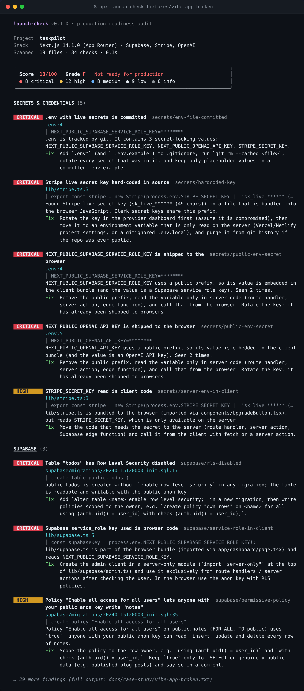
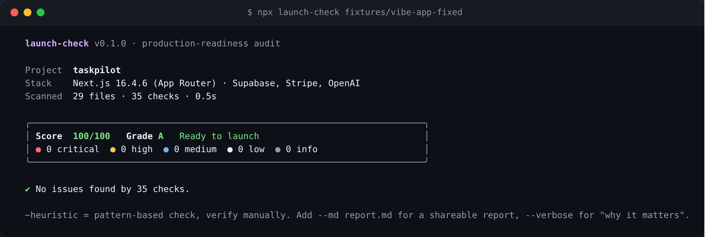
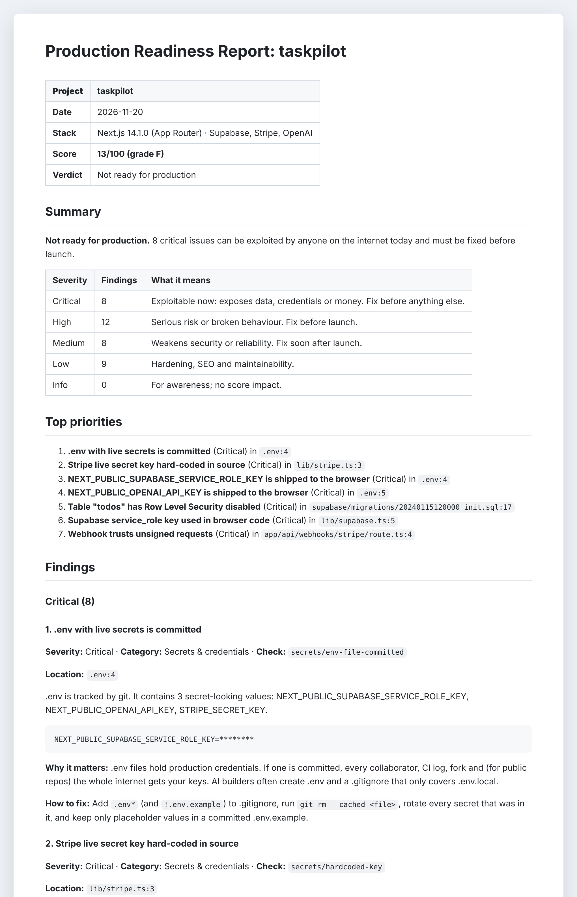

# launch-check

**A production-readiness audit for AI-built web apps.** Point it at a Next.js, Vite + React or Node project generated with Lovable, Bolt, v0, Cursor or Claude Code, and in under a second it tells you what will hurt you in production: leaked API keys, Supabase tables without Row Level Security, API routes anyone can call, unsigned payment webhooks, missing security headers, and the rest of the list below. Every finding comes with `file:line` evidence, why it matters, and how to fix it.

```bash
npx launch-check            # scan the current directory
npx launch-check ./my-app --md report.md   # also write a client-ready Markdown report
```



## Why

AI app builders get you to a working demo fast, and they make the same handful of mistakes every time: the Supabase `service_role` key ends up in the browser bundle, a table never gets `enable row level security`, `NEXT_PUBLIC_` gets added to the OpenAI key to "fix" an undefined variable, a route handler deletes rows for whoever asks, and `ignoreBuildErrors: true` hides everything else. None of these show up in the demo. All of them show up the week after launch.

`launch-check` is the first step of a production-readiness pass: a fast, repeatable, honest list of what to fix, ordered by how badly it can hurt.

- **Real checks, no AI guessing.** Deterministic static analysis: pattern and entropy based secret detection, an import graph that knows which modules end up in the browser bundle, Supabase migrations replayed in order, lockfile parsing.
- **Evidence, not vibes.** Each finding has a location, the offending line (secrets redacted), why it matters and a concrete fix.
- **Honest about its limits.** Pattern-based checks are labelled *heuristic*; see [Limitations](#limitations).
- **Fast and quiet.** Honours `.gitignore`, skips `node_modules` and build output, no network access except the optional `npm audit`. Scans the fixture app in ~0.1 s.
- **CI-ready.** `--fail-on high` exit codes, JSON output, and a [GitHub Action](#ci-usage).

## Quick start

Requires Node.js 20 or newer.

```bash
npx launch-check [path] [options]
```

| Option | What it does |
|---|---|
| `--md <file>` | Write a client-ready Markdown report (summary, top priorities, every finding with evidence and fix) |
| `--prepared-by <name>` | Add a "Prepared by" line to the Markdown report |
| `--json` | Print the full result as JSON |
| `--fail-on <severity>` | Exit 1 if any finding is at or above `critical` (default), `high`, `medium`, `low`, `info`, or `none` |
| `--build` | Also run the project's `build` script and turn compiler errors into findings (dependencies must be installed) |
| `--no-audit` | Skip `npm audit` / `pnpm audit` (the only check that needs network; it degrades to an info note when offline) |
| `--only <ids>` | Run only some rules or categories, e.g. `--only secrets,supabase` |
| `--ignore <glob>` | Ignore extra paths (repeatable). `.gitignore` is always honoured |
| `--verbose` | Show "why it matters" in the terminal too |
| `--summary` | Print only the score box |
| `--list-rules` | List all checks |
| `--no-git` | Do not ask git which files are tracked |

Exit codes: `0` passed, `1` findings at or above `--fail-on`, `2` usage or runtime error.

### What gets detected

The project type is detected from `package.json` and the file tree: **Next.js** (App Router and Pages Router, `src/` or not, `middleware.ts` and Next 16 `proxy.ts`), **Vite + React**, **Create React App**, **Node servers** (Express, Fastify, Koa, Hono), and the integrations **Supabase, Firebase, Prisma, Drizzle, Stripe, OpenAI, Anthropic, Clerk, Auth.js**. Rules that do not apply to the stack are skipped.

"Browser code" is computed, not guessed: launch-check builds the import graph from every `"use client"` module (and Pages Router pages, and the Vite entry in `index.html`), resolves relative and `tsconfig` path-alias imports, stops at `"use server"` boundaries, and reports the import chain as evidence (`lib/stripe.ts is bundled to the browser (imported via components/UpgradeButton.tsx)`).

## Rules

37 checks. Severity is the default; some findings adjust it (a public-read policy is medium, a public-write policy is high).

| Check | Severity | What it finds |
|---|---|---|
| **Secrets** | | |
| `secrets/hardcoded-key` | critical | OpenAI, Anthropic, Stripe (`sk_live`/`rk_live`, `whsec_`), Supabase `service_role` JWTs and `sb_secret_` keys, AWS, Google, GitHub, Slack, SendGrid keys, PEM private keys, database URLs with passwords, plus high-entropy literals assigned to secret-looking names. Placeholders and Supabase anon keys are ignored |
| `secrets/env-file-committed` | critical | `.env` files that are tracked by git or not covered by `.gitignore` (lists the secret variable names, never the values) |
| `secrets/public-env-secret` | critical | Secret-looking variables behind `NEXT_PUBLIC_`, `VITE_`, `REACT_APP_`, `EXPO_PUBLIC_` (e.g. `NEXT_PUBLIC_OPENAI_API_KEY`), in env files or code |
| `secrets/server-env-in-client` | high | Server-only env vars read in modules that reach the browser bundle |
| **Supabase & Firebase** | | |
| `supabase/rls-disabled` | critical | Tables in `public` created in migrations without `enable row level security` (migrations replayed in order; later `enable`/`disable`/`drop` are honoured) |
| `supabase/permissive-policy` | high | Policies with `using (true)` / `with check (true)`; dropped policies are not reported |
| `supabase/service-role-in-client` | critical | The service role key referenced from browser code |
| `firebase/open-security-rules` | critical | `allow read, write: if true`, unconditional `allow`, expired-or-not "test mode" rules, public Realtime Database rules |
| **Application security** | | |
| `security/unauthenticated-route` | high | Route handlers, Pages API routes and server actions that write data or call a privileged/paid API with no visible auth check _(heuristic)_ |
| `security/unverified-webhook` | high | Webhook handlers (Stripe and others) that never verify the signature _(heuristic)_ |
| `security/server-module-in-client` | high | Browser code importing `stripe`, `openai`, database drivers, `firebase-admin`, `server-only`, Node built-ins, `next/headers` |
| `security/dangerously-set-inner-html` | high | `dangerouslySetInnerHTML` with non-constant, unsanitized input |
| `security/eval` | high | `eval`, `new Function`, string-based timers |
| `security/cors-wildcard-credentials` | high | `Access-Control-Allow-Origin: *` or reflected origins combined with credentials |
| `security/sql-injection` | high | Interpolated raw SQL (`$queryRawUnsafe`, `sql.raw`, template-literal `.query`) _(heuristic)_ |
| `security/missing-security-headers` | medium | HSTS, X-Frame-Options/frame-ancestors, X-Content-Type-Options, Referrer-Policy, Permissions-Policy not set in next.config, middleware, `vercel.json`, `netlify.toml`, `_headers` or `helmet()` |
| `security/missing-csp` | medium | No Content-Security-Policy anywhere |
| **Next.js** | | |
| `nextjs/build-checks-disabled` | high | `typescript.ignoreBuildErrors` (high) / `eslint.ignoreDuringBuilds` (low) |
| `nextjs/images-unoptimized` | low | `images.unoptimized: true` on a non-static app |
| `nextjs/missing-error-boundary` | low | No `error.tsx` / `global-error.tsx` (or `_error`) |
| `nextjs/missing-not-found` | low | No `not-found.tsx` (or `404.tsx`) |
| **Dependencies** | | |
| `dependencies/next-middleware-bypass` | critical | Next.js versions affected by CVE-2025-29927 when middleware is used (uses the lockfile version; never guesses from a caret range) |
| `dependencies/vulnerable-packages` | varies | `npm audit --json` / `pnpm audit --json`, parsed into findings (offline-safe) |
| `dependencies/react-version-mismatch` | high | `react` / `react-dom` ranges that differ, or several React majors in the lockfile |
| `dependencies/outdated-framework` | medium | Next.js or React two or more majors behind (Next.js 13 and older: high) |
| `dependencies/missing-lockfile` | medium | No lockfile committed |
| `dependencies/unpinned-version` | medium | `latest`, `*` or open-ended `>=` ranges |
| **Config, SEO, code quality, build** | | |
| `config/typescript-strict` | medium | `strict` off (understands `extends`, solution-style tsconfigs and TypeScript 6+ defaults) |
| `config/env-example` | low | Env vars used in code but missing from `.env.example` (medium if there is no template at all) |
| `seo/missing-metadata` | low | No root `metadata` export, the "Create Next App" placeholder, or a placeholder `<title>` in `index.html` |
| `seo/missing-robots` / `seo/missing-sitemap` | low | No robots.txt / sitemap (file or `app/robots.ts`, `app/sitemap.ts`) |
| `code-quality/any-density` | low | Explicit `any` per 1,000 lines, with the worst files |
| `code-quality/console-log` | low | Leftover `console.log`, counting how many run in the browser |
| `code-quality/debugger` | medium | `debugger` statements |
| `code-quality/todo-comments` | info | TODO/FIXME count, highlighting security-related ones ("TODO: add auth") |
| `build/production-build` | high | With `--build`: runs the build and parses `next build`, `tsc`, Vite/Rollup, esbuild and webpack errors into findings |

### Score

Each finding costs points by severity (critical 20, high 8, medium 3, low 1, info 0; repeats of one rule count half and are capped), mapped onto 0 to 100. Any critical finding caps the grade at D: the arithmetic should never say "B" about an app whose database is public.

## Configuration

Optional `launch-check.config.json` (or `.launch-checkrc.json`, or a `"launchCheck"` key in `package.json`):

```json
{
  "ignore": ["scripts/", "legacy/**"],
  "rules": {
    "code-quality/console-log": "off",
    "security/missing-csp": "low"
  },
  "failOn": "high",
  "thresholds": { "consoleLog": 5, "anyPerKloc": 5 }
}
```

Unknown keys and invalid severities are rejected with a clear error. Individual findings can be suppressed in code, which keeps the reason next to the code:

```ts
// launch-check-ignore-next-line security/eval  -- sandboxed, input is a constant
const fn = new Function(TEMPLATE);
eval(trusted); // launch-check-ignore
/* launch-check-ignore-file security/dangerously-set-inner-html */
```

## CI usage

### GitHub Action

```yaml
# .github/workflows/launch-check.yml
name: launch-check
on: [pull_request]
jobs:
  launch-check:
    runs-on: ubuntu-latest
    steps:
      - uses: actions/checkout@v4
      - uses: OWNER/launch-check@v0.1.0   # the repository hosting launch-check
        with:
          fail-on: high          # critical | high | medium | low | info | none
          # path: apps/web       # for monorepos
          # audit: 'false'       # skip npm audit
          # args: --only secrets,supabase
```

The action writes the Markdown report to the job summary, exposes `score` and `grade` outputs, and fails the job when a finding reaches `fail-on`. A complete example that also uploads the report as an artifact is in [`examples/launch-check.yml`](examples/launch-check.yml).

### Any CI

```bash
npx --yes launch-check@0.1 . --fail-on high --md launch-check-report.md
```

### Programmatic

```ts
import { writeFile } from 'node:fs/promises';
import { audit, renderMarkdown } from 'launch-check';

const result = await audit('./my-app', { audit: false });
console.log(result.score, result.findings.length);
await writeFile('report.md', renderMarkdown(result, { preparedBy: 'Your Studio' }));
```

## Case study: TaskPilot, before and after

[`fixtures/vibe-app-broken`](fixtures/vibe-app-broken) is a small but complete Next.js 14 + Supabase + OpenAI + Stripe app ("TaskPilot", an AI todo list) written the way an AI builder writes it, with the mistakes found again and again in real vibe-coded apps. [`fixtures/vibe-app-fixed`](fixtures/vibe-app-fixed) is the same app after a production-readiness pass. That pass is exactly the deliverable of a "fix and deploy your AI-built app" engagement: the report, the fixes, and a green CI gate.

The tables below are generated from the real output of `npm run case-study` (full terminal output and both Markdown reports are in [`docs/case-study/`](docs/case-study)).

<!-- case-study:start -->
| | Before (`fixtures/vibe-app-broken`) | After (`fixtures/vibe-app-fixed`) |
|---|---|---|
| Score | **13/100 (F)** | **100/100 (A)** |
| Critical | 8 | 0 |
| High | 12 | 0 |
| Medium | 8 | 0 |
| Low | 9 | 0 |
| Info | 0 | 0 |
| `--fail-on high` exit code | 1 (CI fails) | 0 (CI passes) |
| Checks run | 34 | 35 |

<details><summary><b>Every finding in the "before" report</b> (all resolved in the fixed app)</summary>

| Severity | Check | Finding | Location |
|---|---|---|---|
| Critical | `secrets/env-file-committed` | .env with live secrets is committed | `.env:4` |
| Critical | `secrets/hardcoded-key` | Stripe live secret key hard-coded in source | `lib/stripe.ts:3` |
| Critical | `secrets/public-env-secret` | NEXT_PUBLIC_SUPABASE_SERVICE_ROLE_KEY is shipped to the browser | `.env:4` |
| Critical | `secrets/public-env-secret` | NEXT_PUBLIC_OPENAI_API_KEY is shipped to the browser | `.env:5` |
| Critical | `supabase/rls-disabled` | Table "todos" has Row Level Security disabled | `supabase/migrations/20240115120000_init.sql:17` |
| Critical | `supabase/service-role-in-client` | Supabase service_role key used in browser code | `lib/supabase.ts:5` |
| Critical | `security/unverified-webhook` | Webhook trusts unsigned requests _(heuristic)_ | `app/api/webhooks/stripe/route.ts:4` |
| Critical | `dependencies/next-middleware-bypass` | next 14.1.0 allows bypassing middleware.ts | `package.json:13` |
| High | `secrets/server-env-in-client` | STRIPE_SECRET_KEY read in client code | `lib/stripe.ts:3` |
| High | `supabase/permissive-policy` | Policy "Enable all access for all users" lets anyone with your public anon key write "notes" | `supabase/migrations/20240115120000_init.sql:35` |
| High | `security/cors-wildcard-credentials` | CORS allows any origin together with credentials | `app/api/chat/route.ts:5` |
| High | `security/dangerously-set-inner-html` | Unsanitized HTML passed to dangerouslySetInnerHTML | `app/dashboard/page.tsx:59` |
| High | `security/eval` | eval() executes a string as code | `lib/ai-parse.ts:6` |
| High | `security/server-module-in-client` | Client bundle imports "openai" | `lib/openai.ts:1` |
| High | `security/server-module-in-client` | Client bundle imports "stripe" | `lib/stripe.ts:1` |
| High | `security/unauthenticated-route` | Route handler POST /api/chat has no auth check _(heuristic)_ | `app/api/chat/route.ts:14` |
| High | `security/unauthenticated-route` | Route handler DELETE /api/todos/[id] has no auth check _(heuristic)_ | `app/api/todos/[id]/route.ts:5` |
| High | `security/unauthenticated-route` | Server action updateProfile() has no auth check _(heuristic)_ | `app/dashboard/actions.ts:5` |
| High | `nextjs/build-checks-disabled` | TypeScript errors are ignored during `next build` | `next.config.js:8` |
| High | `dependencies/react-version-mismatch` | react "^18.2.0" and react-dom "latest" do not match | `package.json:16` |
| Medium | `security/missing-csp` | No Content-Security-Policy header | `next.config.js` |
| Medium | `security/missing-security-headers` | 5 of 5 recommended security headers missing | `next.config.js` |
| Medium | `dependencies/missing-lockfile` | No lockfile | `package.json` |
| Medium | `dependencies/outdated-framework` | next 14.1.0 is 2 major versions behind | `package.json:13` |
| Medium | `dependencies/unpinned-version` | 1 dependency not pinned | `package.json:16` |
| Medium | `config/env-example` | No .env.example | `lib/openai.ts:4` |
| Medium | `config/typescript-strict` | tsconfig.json: "strict" is set to false | `tsconfig.json:7` |
| Medium | `code-quality/any-density` | 8 explicit `any`s (30.4 per 1,000 lines) | `app/dashboard/actions.ts:7` |
| Low | `nextjs/build-checks-disabled` | ESLint is skipped during `next build` | `next.config.js:11` |
| Low | `nextjs/images-unoptimized` | next/image optimization is turned off | `next.config.js:4` |
| Low | `nextjs/missing-error-boundary` | App Router has no error.tsx | `app` |
| Low | `nextjs/missing-not-found` | App Router has no not-found.tsx | `app` |
| Low | `seo/missing-metadata` | Root layout exports no metadata | `app/layout.tsx` |
| Low | `seo/missing-robots` | No robots.txt |  |
| Low | `seo/missing-sitemap` | No sitemap |  |
| Low | `code-quality/console-log` | 3 console.log calls left in source | `app/dashboard/page.tsx:21` |
| Low | `code-quality/todo-comments` | 2 TODO/FIXME markers, 2 security-related | `app/api/todos/[id]/route.ts:4` |

</details>
<!-- case-study:end -->

The fixed app is not a mock-up: it type-checks with `strict` + `noUncheckedIndexedAccess`, and `next build` succeeds on Next.js 16.4.6 (verified by running `launch-check --build` on a copy of it after `npm ci`; the build parser's test data is real Next.js 16 output from that copy with a type error introduced). Running it with `next start` and probing it returns the security headers on every response, `401 Unauthorized` from `DELETE /api/todos/1` and `POST /api/chat` without a session, `400 Missing signature` from the Stripe webhook for a forged event, and a redirect from `/dashboard` to `/login`.



### What the client receives

The Markdown report (`--md report.md`) is written for the app owner, not for a linter: verdict, severity table, top priorities, then every finding with evidence, why it matters and how to fix it. Secrets are redacted. [Full example report](docs/case-study/vibe-app-broken-report.md).



### Key fixes

**1. Service role key out of the browser, RLS on.** The broken app created its only Supabase client with `NEXT_PUBLIC_SUPABASE_SERVICE_ROLE_KEY` "so we don't get RLS permission errors", and imported it from a `"use client"` page. Anyone could copy the key from the bundle and read or delete the whole database. The fix splits it into three clients: a browser client with the anon key, a cookie-bound server client (`lib/supabase/server.ts`), and an admin client in a `server-only` module used only by the signed webhook. Because the initial migration is already applied, the database fix is a **new migration** ([`20240301090000_lock_down_rls.sql`](fixtures/vibe-app-fixed/supabase/migrations/20240301090000_lock_down_rls.sql)) and launch-check replays both in order:

```sql
alter table public.todos enable row level security;
create policy "Users can delete own todos" on public.todos
  for delete to authenticated using ((select auth.uid()) = user_id);

drop policy "Enable all access for all users" on public.notes;
create policy "Users can manage own notes" on public.notes
  for all to authenticated using ((select auth.uid()) = user_id) with check ((select auth.uid()) = user_id);

-- plan/credits are written only by the Stripe webhook. A column-level REVOKE alone would not
-- work because Supabase grants table-level UPDATE, so revoke it and grant back the safe column.
revoke update on public.profiles from anon, authenticated;
grant update (full_name) on public.profiles to authenticated;
```

**2. Route handlers that check who is calling** (`app/api/todos/[id]/route.ts`):

```diff
 import { NextResponse } from 'next/server';
-import { supabase } from '@/lib/supabase';
-
-// TODO: add auth check before launch
-export async function DELETE(req: Request, { params }: { params: { id: string } }) {
-  const { error } = await supabase.from('todos').delete().eq('id', params.id);
-  if (error) {
-    return NextResponse.json({ error: error.message }, { status: 500 });
-  }
+import { z } from 'zod';
+import { requireUser } from '@/lib/supabase/server';
+
+const Params = z.object({ id: z.coerce.number().int().positive() });
+
+export async function DELETE(_req: Request, { params }: { params: Promise<{ id: string }> }) {
+  const { supabase, user } = await requireUser();
+  if (!user) return NextResponse.json({ error: 'Unauthorized' }, { status: 401 });
+
+  const parsed = Params.safeParse(await params);
+  if (!parsed.success) return NextResponse.json({ error: 'Invalid id' }, { status: 400 });
+
+  // RLS already limits this to the caller's rows; the user_id filter makes the intent explicit.
+  const { error, count } = await supabase
+    .from('todos')
+    .delete({ count: 'exact' })
+    .eq('id', parsed.data.id)
+    .eq('user_id', user.id);
+
+  if (error) return NextResponse.json({ error: 'Could not delete todo' }, { status: 500 });
+  if (count === 0) return NextResponse.json({ error: 'Not found' }, { status: 404 });
   return NextResponse.json({ success: true });
 }
```

The server action that let any visitor update any profile (including `plan` and `credits`, straight from `Object.fromEntries(formData)`) now takes the user id from the session and whitelists one column with zod.

**3. A Stripe webhook that cannot be forged** (`app/api/webhooks/stripe/route.ts`):

```diff
 export async function POST(req: Request) {
-  const event = await req.json();
+  const signature = req.headers.get('stripe-signature');
+  const webhookSecret = process.env.STRIPE_WEBHOOK_SECRET;
+  if (!signature || !webhookSecret) {
+    return NextResponse.json({ error: 'Missing signature' }, { status: 400 });
+  }
+
+  let event: Stripe.Event;
+  try {
+    // Verify against the raw body: a forged "checkout.session.completed" is rejected here.
+    event = getStripe().webhooks.constructEvent(await req.text(), signature, webhookSecret);
+  } catch {
+    return NextResponse.json({ error: 'Invalid signature' }, { status: 400 });
+  }
 
   if (event.type === 'checkout.session.completed') {
-    const userId = event.data.object.metadata.userId;
-    await supabase.from('profiles').update({ plan: 'pro', credits: 1000 }).eq('id', userId);
+    const session = event.data.object;
+    const userId = session.client_reference_id;
+    if (userId && session.payment_status === 'paid') {
+      const { error } = await createAdminClient().from('profiles').update({ plan: 'pro', credits: 1000 }).eq('id', userId);
+      // A 500 makes Stripe retry the event instead of silently losing the upgrade.
+      if (error) return NextResponse.json({ error: 'Database update failed' }, { status: 500 });
+    }
   }
```

**4. Everything else in the report:** the OpenAI call moved from the browser (`NEXT_PUBLIC_OPENAI_API_KEY` + `dangerouslyAllowBrowser: true`) to an authenticated route with a fixed model, capped tokens and zod-validated input; `eval()` on the model's JSON replaced by `JSON.parse` + schema validation; Stripe Checkout created server-side; notes rendered as text instead of `dangerouslySetInnerHTML`; CORS `*` with credentials removed; security headers and a CSP in `next.config.ts`; `.env` removed from git and replaced by a documented `.env.example`; strict TypeScript and no `ignoreBuildErrors`; Next.js upgraded from 14.1.0 (vulnerable to the middleware bypass) to 16.4.6 with `proxy.ts`; a committed lockfile with pinned React; `error.tsx`, `not-found.tsx`, metadata, `robots.ts` and `sitemap.ts`.

### About the fake keys in the fixtures

The broken fixture must contain "secrets" for the detectors to find, but nothing in this repository is a real credential, and none of it is shaped to trip GitHub secret scanning or push protection:

- Every value is labelled: `sk_live_DUMMY-launch-check-fixture-not-a-real-key`, `sk-proj-DUMMY-launch-check-fixture-not-a-real-key-000000`. The hyphens and the word `DUMMY` break the exact formats provider scanners match (for example, real OpenAI keys contain a fixed `T3BlbkFJ` marker and real Stripe keys are purely alphanumeric), while launch-check's patterns deliberately accept them so the fixtures exercise the same code paths.
- The Supabase keys are JWTs built for the fixture: their payload says `"ref":"fakeprojectref000000"` and the signature segment is literally `FAKE-launch-check-fixture-signature-not-a-real-key`, so they cannot be valid for any project.
- The unit tests assemble fake keys at runtime (`['sk_', 'live_', ...].join('')`), so the test sources contain no provider-shaped literals at all.
- Reports never print secrets: every snippet goes through redaction (`sk_live_******…(49 chars)`), and a test asserts the fake values never appear in the JSON output.

## Limitations

launch-check is a fast first pass, not a penetration test. Be aware of what it cannot know:

- **Heuristics produce false positives and false negatives.** `security/unauthenticated-route` looks for auth calls inside the handler body (`auth()`, `getUser`, `getServerSession`, `requireUser`, a `401`, ...). A custom helper with an unusual name will be reported; an auth check that runs but authorizes the wrong thing will not. Endpoints protected only by middleware are reported as `low` on purpose (matchers drift, and CVE-2025-29927 bypassed middleware entirely). Webhook and SQL-injection checks are similarly pattern-based. All heuristic rules are labelled.
- **Static analysis only.** It does not run the app, query your Supabase project, or see dashboard-only configuration: RLS enabled or policies created in the Supabase dashboard rather than in migrations, hosting-level headers set outside the repo, or environment variables configured in Vercel.
- **Secret detection** covers common providers and high-entropy assignments; it cannot recognise every format, and it ignores values that look like placeholders. Git history is not scanned: a key deleted from the code but still in history is still leaked (use `gitleaks` or `trufflehog` for history).
- **Import graph** resolves relative imports and `tsconfig` `paths`; it does not follow imports into `node_modules`, workspace packages of a monorepo, or dynamic `require(variable)`. Scan monorepo apps one at a time (`npx launch-check apps/web`).
- **Version data** (latest Next.js/React majors, the middleware-bypass advisory) is built in and reflects the release of this version; `npm audit` (on by default when a lockfile exists) covers the rest of the advisory database and needs network access.
- **`--build`** runs the project's own build script, so only use it on code you trust, with dependencies already installed.
- Frameworks beyond Next.js, Vite/CRA React and Node servers (Remix, SvelteKit, Nuxt, Astro) get the generic checks only.

## Development

```bash
npm ci
npm test              # vitest: per-rule positive/negative cases + full-report snapshots of both fixtures
npm run typecheck
npm run build
npm run case-study    # regenerate docs/case-study/* and the README case study from real output
npm run screenshots   # re-render docs/images/*.png with Playwright (needs `npm run case-study` first)
node dist/cli.js fixtures/vibe-app-broken
```

Project layout: `src/rules/*` (one module per area, each rule is `{ id, severity, why, fix, appliesTo, run }`), `src/graph.ts` (client-bundle import graph), `src/walker.ts` (`.gitignore`-aware walker), `src/reporters/*` (terminal, JSON, Markdown), `tests/` (vitest), `fixtures/` (the case-study apps).

## License

[MIT](LICENSE) © Cuong Nguyen

---

Built by Cuong Nguyen — full stack developer. Need your app fixed and deployed? Hire me on Fiverr: https://www.fiverr.com/cuongnqxx
